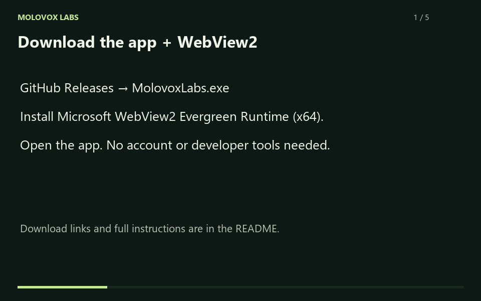
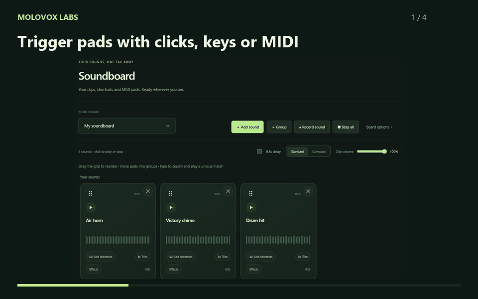

# Molovox Labs

A Windows app for soundboards, video samples and live audio. Mix your microphone with clips, add effects, and record a performance or put one together in the arrangement editor. Keyboard shortcuts and MIDI let you trigger clips while gaming or streaming.

Built by **Molotov**.

Closing or minimizing the window keeps it running in the tray. Tap Alt twice to open Soundboard, or right-click the tray icon to quit.

## Installation



*15-second setup guide. Full steps and clickable downloads are below.*

1. Download **MolovoxLabs.exe** from [Releases](https://github.com/AmirMolotov/MolovoxLabs/releases) and run it on **Windows x64**. No account needed.
2. Install the [WebView2 Evergreen Runtime](https://developer.microsoft.com/en-us/microsoft-edge/webview2/#download) if it isn't already on your computer. Choose the x64 standalone installer or the Evergreen Bootstrapper.
3. Install **FFmpeg 7 or newer** to import, preview, and export media. Molovox Labs needs both `ffmpeg.exe` and `ffprobe.exe`.

### FFmpeg on Windows

1. Open the [official FFmpeg download page](https://ffmpeg.org/download.html). Under **Windows EXE Files**, follow the [gyan.dev Windows builds link](https://www.gyan.dev/ffmpeg/builds/) and download `ffmpeg-release-essentials.zip`.
2. Extract the ZIP to a permanent location. Find the `bin` folder containing `ffmpeg.exe` and `ffprobe.exe`, for example `C:\Tools\ffmpeg\bin`.
3. In the Start menu, search for **Edit environment variables for your account**. Under **User variables**, select **Path → Edit → New** and add the full path to that `bin` folder. Click **OK** to save.

Alternatively, install the prerequisites from PowerShell (accept any administrator prompt):

```powershell
winget install --id Microsoft.EdgeWebView2Runtime --exact --source winget
winget install --id Gyan.FFmpeg --exact --source winget
```

If `winget` is unavailable, use the download links above. These are runtime requirements; you do not need Go, Node.js, Python or Visual Studio to use the downloaded app.

**Add the folder, not the executable:** your PATH entry should look like `C:\Tools\ffmpeg\bin`, not `C:\Tools\ffmpeg\bin\ffmpeg.exe`. Check the extracted folder: ZIPs often contain an extra version-named directory before `bin`. Keep your existing PATH entries; add a new one.

Open a **new** PowerShell window and check:

```powershell
where.exe ffmpeg
where.exe ffprobe
ffmpeg -version
ffprobe -version
```

Both programs must be found. If either is missing, correct the PATH entry using the steps above. Then **quit Molovox Labs from its tray menu and reopen it**; closing its window only minimizes it to the tray, so it will keep the old PATH until restarted.

### Send the mix to Discord with VB-CABLE

1. Download the Windows driver ZIP from [VB-Audio's official VB-CABLE page](https://vb-audio.com/Cable/) and extract **all** its files.
2. Run the x64 setup program as administrator, choose **Install Driver**, and **restart Windows**. This creates the CABLE Input and CABLE Output devices; you do not add them manually.
3. In Molovox Labs, open **Settings** and select **CABLE Input (VB-Audio Virtual Cable)** as an output. Select your headphones as an additional output if you want to hear the mix too.
4. In Discord, open **User Settings → Voice & Video → Input Device** and choose **CABLE Output (VB-Audio Virtual Cable)**.
5. Use **Resume listening** in Molovox Labs. For your voice as well as clips, select your physical microphone in Settings and enable **Microphone → outputs**.

The names are from the cable's point of view: Molovox Labs sends audio **into CABLE Input**; Discord receives it **from CABLE Output**. VB-CABLE is optional for normal playback. Keep your physical microphone as the input in Molovox Labs to avoid routing the cable back into itself.

### If MP3 imports work on one computer but not another

On the failing computer, check **both** FFmpeg commands above and fully restart the app. **Add sound → Choose audio or video…** uses FFmpeg even for MP3 files. VB-CABLE is for routing audio to other apps; it is not required for importing MP3s.

Choose a file, drag the IN/OUT edges, name the selection, then choose **Save sound bite**. Each bite can be up to two minutes; you can keep making bites from the same source. If an import still fails, include the exact message shown in the Add sound dialog when reporting it. MP3 cover images are ignored during audio import.

## A quick look



*10-second tour using generated demo audio in a separate test profile.*

- **Soundboard:** trigger pads with clicks, keyboard shortcuts or MIDI; organize pads into groups.
- **Audio and video sampler:** trim sound bites, crop video samples and perform with video pads.
- **Arrangement:** place clips on tracks and export audio or video.
- **Patch bay:** route microphones and boards through effects to your outputs, including VST3 effects.
- **Recording:** capture audio or a video-sampler performance.

## Your files

Sounds and settings stay on your computer in `%APPDATA%/QuietLab`. Updating the app keeps them. Imported media, recordings and local settings are excluded from Git.

## Building from source

You'll need Go 1.27+, Node.js, Python, and Visual Studio C++ Build Tools with the Windows SDK.

```powershell
.\scriptsuild-windows.ps1 -Run
```

Set `VCVARS64` to your Visual Studio `vcvars64.bat` path if the script can't find it. The script runs the checks and builds one `MolovoxLabs.exe`. Docker is not required. Temporary files and Go build caches go into the ignored `.build/` folder on the project drive; keep free space on that drive.

Source layout and development rules are in [AGENTS.md](AGENTS.md). The Windows application lives in `cmd/molovoxlabs/`; hand-written interface assets live in `web/` and are embedded at build time. Run Go commands from the repository root with `./...` for checks or `./cmd/molovoxlabs` for the application.

See [third-party notices](THIRD-PARTY-NOTICES.txt) for dependency licences.

If the app exits unexpectedly, check `%APPDATA%/QuietLab/logs/app.log` and `app.previous.log`. These retain startup/errors and unhandled Go crash traces from the current and previous session. A forced termination or native plugin crash may leave no Go trace.
